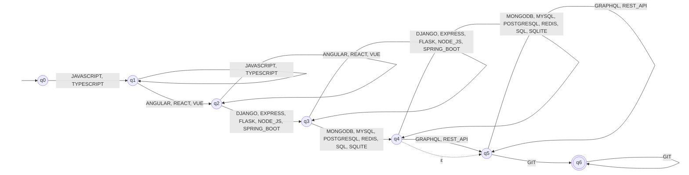
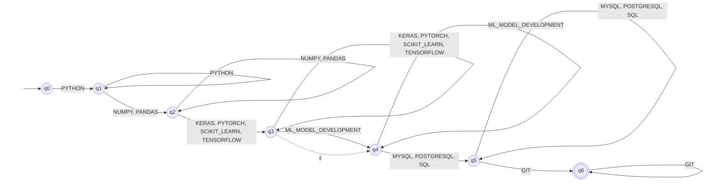
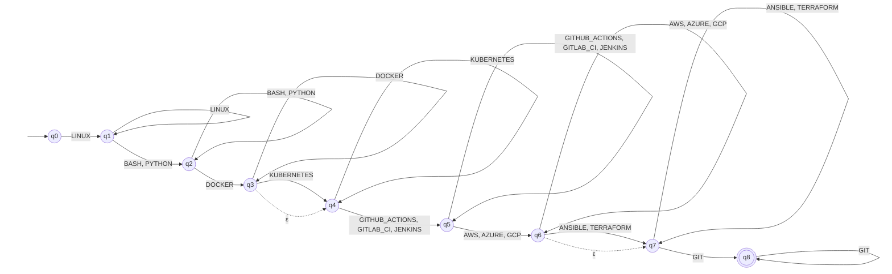
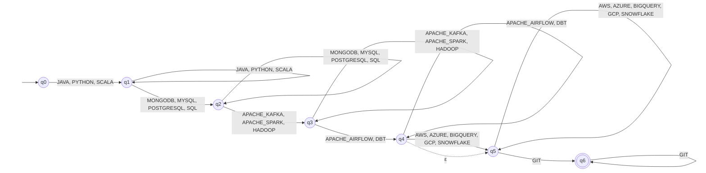

# Profile automata

_Generated by `python -m resumelens.diagrams` from `resumelens/profiles.py`; do not edit by hand._

Solid arrows read a token; a self-loop accepts more tokens of the same category; dashed arrows are ε-transitions that skip an optional category. The double circle is the accepting state.

## Full Stack Developer

Pattern: `C1⁺ C2⁺ C3⁺ C4⁺ C5* C6⁺`

- **Q** = {q0, q1, q2, q3, q4, q5, q6} (7 states)
- **Σ** = {ANGULAR, DJANGO, EXPRESS, FLASK, GIT, GRAPHQL, JAVASCRIPT, MONGODB, MYSQL, NODE_JS, POSTGRESQL, REACT, REDIS, REST_API, SPRING_BOOT, SQL, SQLITE, TYPESCRIPT, VUE} (19 symbols)
- **q0** = q0
- **F** = {q6}
- **Type:** ε-NFA (ε-transitions skip: API)
- **Equivalent minimal DFA:** 7 states, missing transitions go to an implicit dead state

**δ** (for every a in the category):

| Category | Name | Tokens a ∈ Cᵢ | Transitions |
|----------|------|---------------|-------------|
| C1 | Frontend language (required) | JAVASCRIPT, TYPESCRIPT | δ(q0, a) = {q1}, δ(q1, a) = {q1} |
| C2 | Frontend framework (required) | ANGULAR, REACT, VUE | δ(q1, a) = {q2}, δ(q2, a) = {q2} |
| C3 | Backend (required) | DJANGO, EXPRESS, FLASK, NODE_JS, SPRING_BOOT | δ(q2, a) = {q3}, δ(q3, a) = {q3} |
| C4 | Database (required) | MONGODB, MYSQL, POSTGRESQL, REDIS, SQL, SQLITE | δ(q3, a) = {q4}, δ(q4, a) = {q4} |
| C5 | API (optional) | GRAPHQL, REST_API | δ(q4, a) = {q5}, δ(q5, a) = {q5}, δ(q4, ε) = {q5} |
| C6 | Version control (required) | GIT | δ(q5, a) = {q6}, δ(q6, a) = {q6} |

## Machine Learning Engineer

Pattern: `C1⁺ C2⁺ C3⁺ C4* C5⁺ C6⁺`

- **Q** = {q0, q1, q2, q3, q4, q5, q6} (7 states)
- **Σ** = {GIT, KERAS, ML_MODEL_DEVELOPMENT, MYSQL, NUMPY, PANDAS, POSTGRESQL, PYTHON, PYTORCH, SCIKIT_LEARN, SQL, TENSORFLOW} (12 symbols)
- **q0** = q0
- **F** = {q6}
- **Type:** ε-NFA (ε-transitions skip: ML practice)
- **Equivalent minimal DFA:** 7 states, missing transitions go to an implicit dead state

**δ** (for every a in the category):

| Category | Name | Tokens a ∈ Cᵢ | Transitions |
|----------|------|---------------|-------------|
| C1 | Language (required) | PYTHON | δ(q0, a) = {q1}, δ(q1, a) = {q1} |
| C2 | Data processing (required) | NUMPY, PANDAS | δ(q1, a) = {q2}, δ(q2, a) = {q2} |
| C3 | ML library (required) | KERAS, PYTORCH, SCIKIT_LEARN, TENSORFLOW | δ(q2, a) = {q3}, δ(q3, a) = {q3} |
| C4 | ML practice (optional) | ML_MODEL_DEVELOPMENT | δ(q3, a) = {q4}, δ(q4, a) = {q4}, δ(q3, ε) = {q4} |
| C5 | Database (required) | MYSQL, POSTGRESQL, SQL | δ(q4, a) = {q5}, δ(q5, a) = {q5} |
| C6 | Version control (required) | GIT | δ(q5, a) = {q6}, δ(q6, a) = {q6} |

## DevOps Engineer

Pattern: `C1⁺ C2⁺ C3⁺ C4* C5⁺ C6⁺ C7* C8⁺`

- **Q** = {q0, q1, q2, q3, q4, q5, q6, q7, q8} (9 states)
- **Σ** = {ANSIBLE, AWS, AZURE, BASH, DOCKER, GCP, GIT, GITHUB_ACTIONS, GITLAB_CI, JENKINS, KUBERNETES, LINUX, PYTHON, TERRAFORM} (14 symbols)
- **q0** = q0
- **F** = {q8}
- **Type:** ε-NFA (ε-transitions skip: Orchestration, Infrastructure as code)
- **Equivalent minimal DFA:** 9 states, missing transitions go to an implicit dead state

**δ** (for every a in the category):

| Category | Name | Tokens a ∈ Cᵢ | Transitions |
|----------|------|---------------|-------------|
| C1 | Operating system (required) | LINUX | δ(q0, a) = {q1}, δ(q1, a) = {q1} |
| C2 | Scripting (required) | BASH, PYTHON | δ(q1, a) = {q2}, δ(q2, a) = {q2} |
| C3 | Containers (required) | DOCKER | δ(q2, a) = {q3}, δ(q3, a) = {q3} |
| C4 | Orchestration (optional) | KUBERNETES | δ(q3, a) = {q4}, δ(q4, a) = {q4}, δ(q3, ε) = {q4} |
| C5 | CI/CD (required) | GITHUB_ACTIONS, GITLAB_CI, JENKINS | δ(q4, a) = {q5}, δ(q5, a) = {q5} |
| C6 | Cloud (required) | AWS, AZURE, GCP | δ(q5, a) = {q6}, δ(q6, a) = {q6} |
| C7 | Infrastructure as code (optional) | ANSIBLE, TERRAFORM | δ(q6, a) = {q7}, δ(q7, a) = {q7}, δ(q6, ε) = {q7} |
| C8 | Version control (required) | GIT | δ(q7, a) = {q8}, δ(q8, a) = {q8} |

## Data Engineer

Pattern: `C1⁺ C2⁺ C3⁺ C4⁺ C5* C6⁺`

- **Q** = {q0, q1, q2, q3, q4, q5, q6} (7 states)
- **Σ** = {APACHE_AIRFLOW, APACHE_KAFKA, APACHE_SPARK, AWS, AZURE, BIGQUERY, DBT, GCP, GIT, HADOOP, JAVA, MONGODB, MYSQL, POSTGRESQL, PYTHON, SCALA, SNOWFLAKE, SQL} (18 symbols)
- **q0** = q0
- **F** = {q6}
- **Type:** ε-NFA (ε-transitions skip: Cloud / warehouse)
- **Equivalent minimal DFA:** 7 states, missing transitions go to an implicit dead state

**δ** (for every a in the category):

| Category | Name | Tokens a ∈ Cᵢ | Transitions |
|----------|------|---------------|-------------|
| C1 | Language (required) | JAVA, PYTHON, SCALA | δ(q0, a) = {q1}, δ(q1, a) = {q1} |
| C2 | Database (required) | MONGODB, MYSQL, POSTGRESQL, SQL | δ(q1, a) = {q2}, δ(q2, a) = {q2} |
| C3 | Big data (required) | APACHE_KAFKA, APACHE_SPARK, HADOOP | δ(q2, a) = {q3}, δ(q3, a) = {q3} |
| C4 | Orchestration (required) | APACHE_AIRFLOW, DBT | δ(q3, a) = {q4}, δ(q4, a) = {q4} |
| C5 | Cloud / warehouse (optional) | AWS, AZURE, BIGQUERY, GCP, SNOWFLAKE | δ(q4, a) = {q5}, δ(q5, a) = {q5}, δ(q4, ε) = {q5} |
| C6 | Version control (required) | GIT | δ(q5, a) = {q6}, δ(q6, a) = {q6} |

